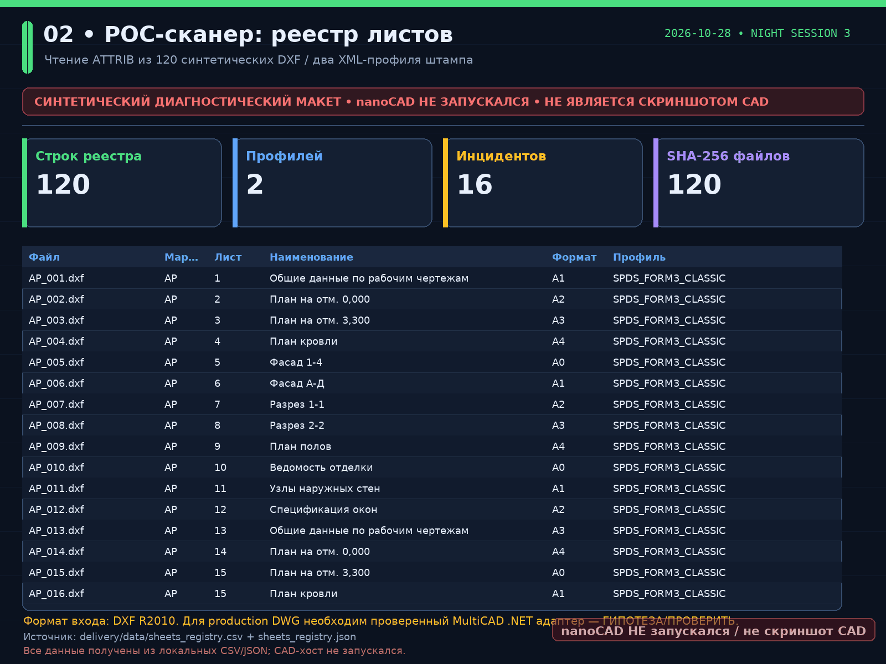

# Ночной отчет ИИ-куратора — 2026-10-28 (третья сессия)

## Самостоятельный Test Runner

`delivery/navigator-kit-test-runner.zip` — исходники, fixtures и результаты для повторения
28 pytest-тестов. `README_test_runner.md` содержит установку минимальных зависимостей.
Проверены Python 3.11/Linux и запуск из распакованного архива в отдельном venv.
`pytest_output.log`, `collect_log.txt`, `test_report.json` — в `delivery/linux-stand/`.
59 delivery checks — отдельный verifier; Windows/macOS не проверены запуском.
Это не двоичный nanoCAD-плагин. Сборщик проверяет ограничение ZIP ≤3 MB.

> **Статус честности:** локальный контур `VERIFIED_LOCALLY`, nanoCAD 26 **не запускался**. Прежние диагностические PNG — макеты; linux_stamp_*.png — реальные DXF-рендеры. Все снабжены watermark и не являются снимками CAD. C# код синтаксически разобран tree-sitter; portable сборка подготовлена для Windows workflow, но в Linux sandbox не выполнялась (`dotnet` отсутствует).
>
> **Вторая сессия 2026-10-27.** PR #1 получил обновлённый нормативный слой, именованные артефакты, Windows workflow и 12 PNG с полупрозрачным водяным знаком.
>
> **Третья сессия 2026-10-28.** Выполнен P0–P2 проход: повторный нормоконтроль по официальному изданию, подготовка Windows-стенда, synthetic production pipeline, SHEETSET/print-order probe и GIF-демо ≤3 МБ. Реальные nanoCAD/DWG по-прежнему недоступны; метки **ГИПОТЕЗА/ПРОВЕРИТЬ** сохранены.

## Что сделано за ночь

1. **Загрузка контекста** — репозиторий был пустым: только `README.md` из 16 байт и initial commit `7e4fcf3`. Issue/PR на старте отсутствовали. Восстановлен суррогат `briefing.md` с явной пометкой, что оригинал отсутствует.
2. **Зависимости** — проверены OS, Python, Node, .NET, nanoCAD, SDK, лицензия. `lk.nanocad.ru/education/request` требует nanoPassport; лицензию автономно получить нельзя.
3. **POC-сканер** — созданы и реально прочитаны **120 валидных DXF R2010** (3 марки × 40 листов) с атрибутами штампов. Получены `sheets_registry.csv/json`, 120 SHA-256.
4. **Штатная ф.1** — документарный эксперимент по SHEETSET, «Insert Sheet List Table», извлечению данных, `GetSheets()` и `GetSheetSets()`. Последний публично не подтверждён; прямая генерация `.dst` не выполнялась.
5. **XML-профиль** — master `stamp_mapping.xml`, два примера `spds_template_a.xml`/`spds_template_b.xml`, XSD-схема; атрибуты ↔ поля реестра.
6. **Обратимая правка** — dry-run → `.bak` → apply → verify → rollback на изолированных DXF-копиях; SHA-256 исходного и восстановленного совпадают. Исходники не изменены.
7. **Ведомости ф.1/ф.2** — CSV с строгими графами, мастер-файлы с техническими колонками, markdown-черновики. Нормативная база переключена на приложение Б ГОСТ Р 21.101-2026.
8. **Контроль комплектности** — 16 инцидентов, включая дубли, пустые графы, неверные форматы, « file ↔ registry » и « doc ↔ file » расхождения.
9. **Нумератор** — 4 группы дублей; подготовлены minimal patch и full shift на 120 листов, без автоматической правки исходников.
10. **Таблица изменений** — пустой шаблон из 5 граф и технический реестр операций. Исправлена ошибка задания: «Аннулир.» не является значением графы «Лист».
11. **Порядок печати** — 120 элементов, совпадение с формой 1 по хэшу; `.dst` не редактировался.
12. **Код и визуализация** — C# Core/CLI/плагин-скелет, Python reference CLI, 15 PNG 1600×1200, HTML dashboard, log, manifest, ZIP.
13. **Продолжение 2026-10-27** — повторная проверка официального реестра ГОСТ, XSD-совместимый XML-маппинг с атрибутами номера листа/формата, DOCX/CSV шаблоны, Python-нумератор, разделённая таблица изменений, Windows workflow и обновлённый PR #1.
14. **Сессия 2026-10-28** — P0-нормоконтроль по официальному PDF и разделу 7, Windows-stand инструкция, `tools/pipeline.py`, SHEETSET probe, GIF-демо, senior review и новый `next_steps.md`.

## Артефакты второй сессии

| Файл | Назначение |
|---|---|
| `delivery/completeness_report.md` | 16 инцидентов, 4 группы дублей, честная формулировка (не все — «нет файла»). |
| `delivery/data/completeness_chart.png` | график инцидентов с подписью «nanoCAD НЕ запускался / не скриншот CAD». |
| `delivery/data/wo1_template.csv`, `delivery/data/wo1_template.docx` | данные формы 1 по Приложению Б ГОСТ Р 21.101-2026. |
| `delivery/data/wo2_template.csv` | данные формы 2 по Приложению Б ГОСТ Р 21.101-2026. |
| `delivery/numbering_patch.py` | подготовка minimal patch и full shift, без записи в исходные DXF. |
| `delivery/changes_table.md` | нормативная таблица ГОСТ Р 2.503-2023 + отдельная операционная таблица. |
| `delivery/next_steps.md` | 5 задач P0–P2. |
| `delivery/night-session-2.md`, `logs/night-session-2.log` | хронология второй сессии. |
| `.github/workflows/windows-build.yml` | ручная сборка C# на будущей Windows-VM. |
| `docs/normative-audit.md`, `docs/windows-vm-build.md` | повторная проверка реестра и инструкция по VM. |

## Артефакты третьей сессии

| Файл | Назначение |
|---|---|
| `delivery/session-3/` | все результаты P0–P2, manifest и логи сессии. |
| `delivery/session-3/demo.gif` | 6-кадровое демо ≤3 МБ с верхним баннером и нижним watermark. |
| `delivery/session-3/demo_storyboard.png` | раскадровка GIF 1600×1200 с watermark. |
| `delivery/session-3/official_text_extract.md` | выписка из официального издания ГОСТ Р 21.101-2026: Приложение Б и раздел 7. |
| `delivery/data/norms_registry.json` | JSON-список норм с полями `norm`, `edition`, `date_force`, `source`. |
| `tools/pipeline.py` | synthetic backend выполнен; MultiCAD backend — честная заглушка. |
| `tools/sheetset_probe.py` | проверка print order и гипотез `GetSheets()`/`GetSheetSets()`. |
| `tools/make_demo_gif.py` | генератор GIF на локальных данных, без CAD-скриншотов. |
| `tools/windows_stand_check.ps1` | PowerShell-чек будущего Windows-стенда. |
| `delivery/session-3/senior_review.md` | что проверено и что осталось с **ГИПОТЕЗА/ПРОВЕРИТЬ**. |

## Ключевые показатели

| Показатель | Значение |
|---|---:|
| Синтетических DXF | 120 |
| Строк реестра / формы 1 / печати | 120 / 120 / 120 |
| Инцидентов комплектности | 16 |
| Групп дублей | 4 |
| PNG-макетов | 15 |
| Локальных проверок | 59 required, 0 failed |
| Rollback / print consistency | True / True |

Распределение инцидентов:

- `DOC_FILE_NOT_IN_REGISTRY` — 1
- `DOC_IN_REGISTRY_NO_FILE` — 2
- `DUPLICATE_SHEET_NUMBER` — 4
- `EMPTY_STAMP_FIELD` — 2
- `FILE_NOT_IN_REGISTRY` — 1
- `INVALID_FORMAT` — 2
- `IN_REGISTRY_NO_FILE` — 1
- `SEQUENCE_GAP` — 3

## Ключевые скриншоты (все — не nanoCAD)

| № | Файл | Сюжет |
|---:|---|---|
| 01 | `screenshot_01_environment.png` | Окружение |
| 02 | `screenshot_02_poc_scan.png` | POC-сканер |
| 03 | `screenshot_03_api_attempt.png` | API-эксперимент |
| 04 | `screenshot_04_xml_profile.png` | XML-маппинг |
| 05 | `screenshot_05_form1.png` | Форма 1 |
| 06 | `screenshot_06_form2.png` | Форма 2 |
| 07 | `screenshot_07_completeness.png` | Контроль комплектности |
| 08 | `screenshot_08_numbering.png` | Нумерация |
| 09 | `screenshot_09_stamp_rollback.png` | Обратимая правка |
| 10 | `screenshot_10_change_table.png` | Таблица изменений |
| 11 | `screenshot_11_print_order.png` | Порядок печати |
| 12 | `screenshot_12_architecture.png` | Архитектура |
| 13 | `screenshot_13_session3_pipeline.png` | Сессия 3 P0-P2 |
| 14 | `screenshot_14_windows_dependency.png` | Windows-стенд |
| 15 | `screenshot_15_demo_storyboard.png` | GIF-демо |

Пример вставки в чат:



## Нормативные находки — обязательно к ревью

- **Повторная проверка 2026-10-28:** [официальное издание ГОСТ Р 21.101-2026](https://pravdaosro.ru/wp-content/uploads/2026/03/GOST-R-21.101-2026.pdf) подтверждает «ВЗАМЕН ГОСТ Р 21.101—2020», дату введения 01.04.2026 и обязательное Приложение Б; раздел 7 уточняет правила изменений и форму 10. Полный защищённый текст не перераспространяется.
- **Повторная проверка 2026-10-27:** [Росстандарт, ГОСТ Р 21.101-2026](https://protect.gost.ru/gost/details/17bc12e8-6579-4145-b141-56855e772e7f) — «Действует», приказ 129-ст от 12.02.2026, введение 01.04.2026; [ГОСТ Р 2.503-2023](https://protect.gost.ru/document.aspx?control=7&id=256448) — «Действует» с 01.03.2024; [ГОСТ 2.503-2013](https://protect.gost.ru/gost/details/03d72f0a-a11e-436f-ba81-41f9333ccc39) — «Утратил силу в РФ».
- **ГОСТ Р 21.101-2020 утратил силу**: действует ГОСТ Р 21.101-2026 с 01.04.2026; формы 1/2 — приложение Б.
- **ГОСТ 2.503-2013 утратил силу в РФ**: действует ГОСТ Р 2.503-2023; для СПДС также проверять раздел 7 ГОСТ Р 21.101-2026.
- **ГОСТ 2.301-68** пока применяется для проверки обозначений форматов; вопрос досрочного применения ГОСТ Р 2.301-2026 требует уточнения.
- Точные размеры граф форм 1/2, приоритет требований об изменениях и соответствие штатной таблицы SHEETSET остаются **ГИПОТЕЗА/ПРОВЕРИТЬ**.

Подробности: [`../docs/standards-warning.md`](../docs/standards-warning.md), [`../docs/sources.md`](../docs/sources.md).

## API-выводы

- `GetSheets()` — только исторический пример MultiCAD.NET 2015; SDK 26 не проверен.
- `GetSheetSets()` — публичного подтверждения не найдено; в коде не вызывается.
- «Извлечение данных из нескольких DWG» — по форуму 2025 года «из коробки нет».
- Подготовлен `src/NavigatorKit.NanoCad/SdkProbe.cs` для reflection-дампа реальных методов без догадок.

## GitHub-действия

- Ветка: `arena/ec9fddc1-navigator-kit` (создавать `night-session-YYYYMMDD` нельзя: имя ветки зафиксировано сессией Arena).
- Коммит на момент генерации отчёта: `2f57aa65019baed1e4e9ea22433b315f83be5dda`.
- PR: [https://github.com/Igorr112323/NAVIGATOR-KIT/pull/1](https://github.com/Igorr112323/NAVIGATOR-KIT/pull/1).
- Push: `git push origin arena/ec9fddc1-navigator-kit`.
- PR body: `delivery/PR_BODY.md`.

## Что сделать до следующего раза (3–5 пунктов)

Подробный чек-лист: [`next_steps.md`](next_steps.md).

1. **P0 — Реальный Windows-стенд.** nanoCAD 26 + лицензия + SDK 26, `NK_HELLO`, `SDK_PROBE`, TFM/DLL и 3 реальных снимка.
2. **P0 — Нормоконтроль геометрии.** Сверить размеры граф форм 1/2, форму 10 и приоритет раздела 7 по официальному изданию.
3. **P1 — 3 × 40 реальных DWG.** Проверить `Database`/`Transaction`, запись атрибутов и rollback SHA-256 через реальный адаптер.
4. **P1 — SHEETSET/Tables/`.dst`.** Подтвердить `GetSheets()`/`GetSheetSets()` и синхронизировать layouts с `delivery/session-3/print_order.json`.
5. **P2 — Конкурсное демо.** GIF/MP4 ≤3 МБ из реального nanoCAD, финальный senior review и снятие оставшихся гипотез.

## Воспроизведение

```bash
python3 -m venv .venv
.venv/bin/pip install -r requirements.txt
.venv/bin/python tools/generate_fixtures.py
python3 tools/navigator_kit.py all
python3 tools/night_session_2.py
python3 tools/session3_runner.py
.venv/bin/python tools/render_screenshots.py
python3 tools/finalize_delivery.py
python3 tools/verify_delivery.py --check-only
```

---
**Конец отчета.**
