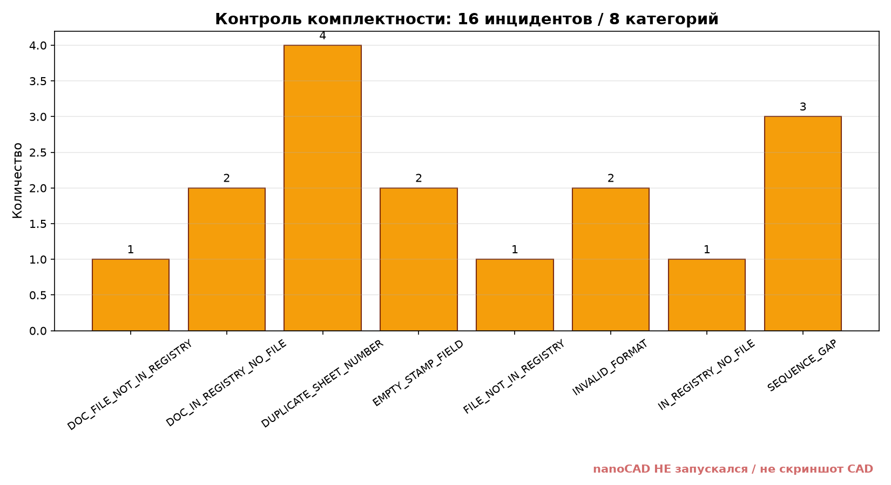

# Отчёт о комплектности — session 3 (2026-10-28)

> Сгенерировано `tools/pipeline.py` из 120 синтетических DXF R2010. nanoCAD **не запускался**. График и PNG — диагностические материалы с водяным знаком.

## Сводка

| Показатель | Значение |
|---|---:|
| Инцидентов | **16** |
| Категорий | 8 |
| Групп дублей | **4** |
| Уровни критичности | ERROR: 12, WARN: 4 |

Обнаружено 4 группы дублей и 16 инцидентов.

**Важно:** нельзя утверждать, что все 16 инцидентов — «есть в ведомости, нет файла»: это сумма разных классов.

## Распределение по кодам

| Код | Количество |
|---|---:|
| `DOC_FILE_NOT_IN_REGISTRY` | 1 |
| `DOC_IN_REGISTRY_NO_FILE` | 2 |
| `DUPLICATE_SHEET_NUMBER` | 4 |
| `EMPTY_STAMP_FIELD` | 2 |
| `FILE_NOT_IN_REGISTRY` | 1 |
| `INVALID_FORMAT` | 2 |
| `IN_REGISTRY_NO_FILE` | 1 |
| `SEQUENCE_GAP` | 3 |

## Все 16 инцидентов

| ID | Код | Уровень | Марка | Лист | Поле | Сообщение | Рекомендация |
|---|---|---|---|---|---|---|---|
| ISS-0001 | EMPTY_STAMP_FIELD | ERROR | КР | 12 | sheet_name | Пустая обязательная графа штампа «sheet_name». | Заполнить атрибут блока основной надписи и повторить сканирование. |
| ISS-0002 | INVALID_FORMAT | ERROR | КР | 20 | format | Обозначение формата «B4» не найдено среди основных/производных форматов. | Проверить обозначение и размеры рамки по ГОСТ 2.301-68. |
| ISS-0003 | INVALID_FORMAT | ERROR | ОВ | 18 | format | Обозначение формата «A6» не найдено среди основных/производных форматов. | Проверить обозначение и размеры рамки по ГОСТ 2.301-68. |
| ISS-0004 | EMPTY_STAMP_FIELD | ERROR | ОВ |  | sheet_no | Пустая обязательная графа штампа «sheet_no». | Заполнить атрибут блока основной надписи и повторить сканирование. |
| ISS-0005 | DUPLICATE_SHEET_NUMBER | ERROR | АР | 15 | sheet_no | Номер листа 15 используется 2 разами. | Утвердить minimal patch или полный сдвиг нумерации. |
| ISS-0006 | DUPLICATE_SHEET_NUMBER | ERROR | АР | 27 | sheet_no | Номер листа 27 используется 2 разами. | Утвердить minimal patch или полный сдвиг нумерации. |
| ISS-0007 | DUPLICATE_SHEET_NUMBER | ERROR | КР | 7 | sheet_no | Номер листа 7 используется 2 разами. | Утвердить minimal patch или полный сдвиг нумерации. |
| ISS-0008 | DUPLICATE_SHEET_NUMBER | ERROR | ОВ | 21 | sheet_no | Номер листа 21 используется 2 разами. | Утвердить minimal patch или полный сдвиг нумерации. |
| ISS-0009 | SEQUENCE_GAP | WARN | АР |  | sheet_no | Нарушена последовательность номеров листов. | Отсутствуют номера: 16, 28 |
| ISS-0010 | SEQUENCE_GAP | WARN | КР |  | sheet_no | Нарушена последовательность номеров листов. | Отсутствуют номера: 8 |
| ISS-0011 | SEQUENCE_GAP | WARN | ОВ |  | sheet_no | Нарушена последовательность номеров листов. | Отсутствуют номера: 22, 33 |
| ISS-0012 | IN_REGISTRY_NO_FILE | ERROR | АР | 41 | file | Есть запись в эталонном реестре, но физический лист отсутствует. | Найти файл или удалить запись после согласования с ГИПом. |
| ISS-0013 | FILE_NOT_IN_REGISTRY | ERROR | АР | 40 | file | Файл листа отсутствует в эталонном реестре. | Добавить лист в реестр/ведомость или исключить из комплекта. |
| ISS-0014 | DOC_IN_REGISTRY_NO_FILE | ERROR |  |  | file | Документ есть в ведомости ф.2, но файл отсутствует. | Вложить документ или скорректировать ведомость. |
| ISS-0015 | DOC_IN_REGISTRY_NO_FILE | ERROR |  |  | file | Документ есть в ведомости ф.2, но файл отсутствует. | Вложить документ или скорректировать ведомость. |
| ISS-0016 | DOC_FILE_NOT_IN_REGISTRY | WARN |  |  | file | Файл в папке документов не внесён в ведомость ф.2. | Добавить в раздел «Ссылочные» или «Прилагаемые документы». |

## 4 группы дублей

| Марка | Лист | Кол-во | Хранитель | Файлы | Рекомендация |
|---|---|---:|---|---|---|
| АР | 15 | 2 | samples/synthetic_sets/АР/АР_015.dxf | samples/synthetic_sets/АР/АР_015.dxf; samples/synthetic_sets/АР/АР_016.dxf | Утвердить full_shift; minimal patch оставляет разрывы в последовательности. |
| АР | 27 | 2 | samples/synthetic_sets/АР/АР_027.dxf | samples/synthetic_sets/АР/АР_027.dxf; samples/synthetic_sets/АР/АР_028.dxf | Утвердить full_shift; minimal patch оставляет разрывы в последовательности. |
| КР | 7 | 2 | samples/synthetic_sets/КР/КР_007.dxf | samples/synthetic_sets/КР/КР_007.dxf; samples/synthetic_sets/КР/КР_008.dxf | Утвердить full_shift; minimal patch оставляет разрывы в последовательности. |
| ОВ | 21 | 2 | samples/synthetic_sets/ОВ/ОВ_021.dxf | samples/synthetic_sets/ОВ/ОВ_021.dxf; samples/synthetic_sets/ОВ/ОВ_022.dxf | Утвердить full_shift; minimal patch оставляет разрывы в последовательности. |

## Статус production DWG

Реальные DWG и MultiCAD .NET SDK 26 отсутствуют. Этот отчёт подтверждает воспроизводимость synthetic backend, а не чтение production DWG. См. `delivery/session-3/p1_production_dwg.json`.
