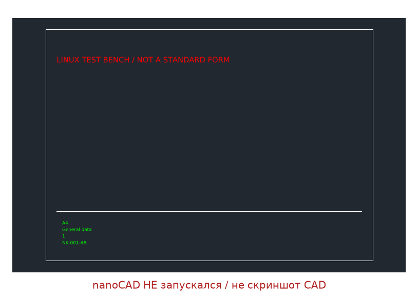

# Linux-стенд «Комплект-Навигатор» — 28.10.2026

**Реально выполнено на Linux / Python 3.11.2. dotnet отсутствует. nanoCAD НЕ запускался.**



## Повторить

Из корня репозитория:
```sh
python3 -m venv .venv
.venv/bin/pip install -r requirements.txt
.venv/bin/python tools/run_linux_stand.py
```
Полный вывод запуска и восьми pytest-тестов: [run.log](run.log).
Машиночитаемые результаты, SHA-256 DXF/PNG: [verification.json](verification.json).

| Фича | Результат | DXF / PNG | Что НЕ проверено |
|---|---|---|---|
| Параметрический штамп: обозначение, лист, название, формат | PASS, roundtrip | [DXF](hello_stamp.dxf), [PNG](hello_stamp.png) | Реальные СПДС-объекты и профили поставщиков |
| Обязательное поле и положительный номер листа | PASS, пойманы 2 посаженные ошибки | тот же DXF, дефекты проверяются в памяти | ПРОВЕРИТЬ ПО ТЕКСТУ ГОСТ: это контракт проекта, не нормативная сертификация |
| Независимая перечитка ASCII group codes | PASS: 1 полилиния, 1 линия, 1 TEXT, 1 INSERT, 4 ATTRIB, 1 SEQEND | тот же DXF | Читатель ограничен тестовым ASCII DXF; не универсальный DWG/DXF-парсер |
| Границы рамки, слои, точные значения четырёх атрибутов | PASS: 0,0–297,210; FRAME/STAMP/NOTES | тот же DXF | ГИПОТЕЗА/ПРОВЕРИТЬ: геометрия настоящих форм |
| Рендер сохранённого DXF + ezdxf audit | PASS, изображение просмотрено | тот же PNG | Это не пиксельное сравнение с nanoCAD |
| Изоляция ядра, отказ MulticadBackend, дубли атрибутов | PASS | автотесты | Реализация MultiCAD SDK 26 отсутствует |

## Архитектура и границы результата

`linux_stand/core/`: geometry, ICadBackend (Protocol), vedmist, normcontrol — без CAD API.
`dxf_backend.py`: реальная реализация на ezdxf.
`independent_reader.py`: отдельный читатель пар DXF без ezdxf и без парсера приложения.
`multicad_backend.py`: **явный NotImplementedError**, не фиктивный рабочий backend.
Существующее C#-ядро и прежний pipeline не заменены: это изолированный первый стенд.
Парсер нового стенда поддерживает только подготовленный NK_STAMP, не все 120 профилей.

Порт Python → C# ещё предстоит; обещание «поменять один файл» сейчас неприменимо.
После переноса ядра и подтверждения SDK следует отдельно проверить транзакции,
блоки/атрибуты, кодировки и шрифты, layouts, единицы, печать, rollback,
McCustomBase, ручки/реакторы при их использовании. Проверки геометрии не доказывают
совпадение визуализации или поведения в nanoCAD.

## Что сделать до следующего раза

1. Подключить два существующих XML-профиля штампов и реальные подготовленные DXF.
2. Добавить отрицательные fixtures, вложенные блоки и трансформации, затем сравнить с текущим реестром 120 листов.
3. Уточнить геометрию по официальному тексту ГОСТ; не выдавать демо за форму 1/2.
4. Перенести контракт ядра в C#, прогнать одинаковые fixtures на обоих языках.
5. На Windows/nanoCAD 26 проверить SDK и настоящий адаптер, снять реальные скриншоты.
